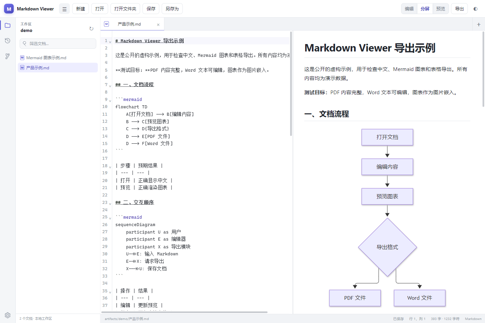

# Markdown Viewer

基于 Tauri、Vite 和 CodeMirror 的桌面 Markdown 编辑器。



Windows 安装包可从 [GitHub Releases](https://github.com/holylong/markdown-viewer/releases/latest) 下载，推荐使用 `x64-setup.exe`。

## 功能

- 编辑、分栏预览和独立预览模式
- Mermaid 图表渲染
- PDF 导出与 Word（DOCX）导出，包含图表图片
- 多文档标签、文件夹浏览和文档右键菜单
- 每个文档独立记住编辑与预览滚动位置
- 分屏模式下编辑区与预览区按滚动进度双向同步
- 中文文本与主题切换

## 开发

需要 Node.js 22 或更新版本、Rust 和 Tauri 2 对应平台的构建依赖。Windows 构建需要 Visual Studio C++ Build Tools 和 WebView2。

```sh
npm ci
npm run tauri -- dev
```

## 构建

```sh
npm run tauri -- build
```

Windows 下也可以运行 `build.cmd --exe --skip-install`，仅生成 EXE。默认输出目录为 `src-tauri/target/release`。运行 `build.cmd --skip-install` 可同时生成安装包，输出位于 `src-tauri/target/release/bundle`。

推送与 `src-tauri/tauri.conf.json` 版本一致的 `v*` 标签时，GitHub Actions 会运行测试、构建 Windows x64 EXE/MSI 安装包，并发布到 GitHub Releases。发布说明位于 `docs/releases/<标签>.md`。

## 验证

```sh
node --experimental-test-module-mocks --test src/mermaid-preview.test.js src/document-export.test.js src/markdown-rendering.test.js src/scroll-memory.test.js src/scroll-sync.test.js
```

公开示例位于 `docs/mermaid-preview.md` 和 `docs/export-sample 中文示例.md`。

浏览器导出验证：运行 `node scripts/verify-export.mjs`，然后打开输出的本地地址。生成结果保存在 `artifacts/export-verification`。DOCX 检查脚本 `scripts/verify-docx.py` 需要 Python 和 Pillow；`scripts/verify-word.ps1` 需要 Windows 和 Microsoft Word。

桌面自动验证脚本连接开启调试端口的 WebView2（9224），浏览器自动验证脚本使用 9223。这些端口仅用于本地测试。多文档滚动隔离可用 `node scripts/verify-scroll-desktop.mjs` 在 9224 端口上验证。

## 数据与导出

文档读取和导出在本地进行。PDF 以图片页面保存；Word 保留可编辑文本和表格，Mermaid 图表嵌入为 PNG。

本仓库发布源码、公开示例及验证脚本。本地会话记录、开发日志、私有文档和构建产物通过 `.gitignore` 排除。
