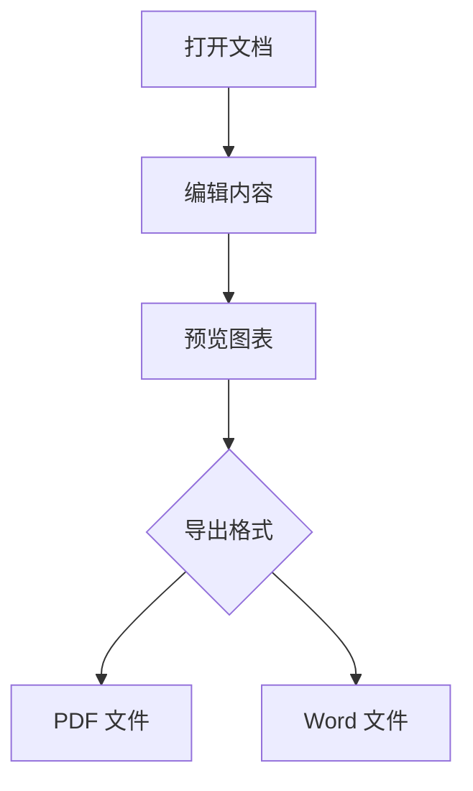
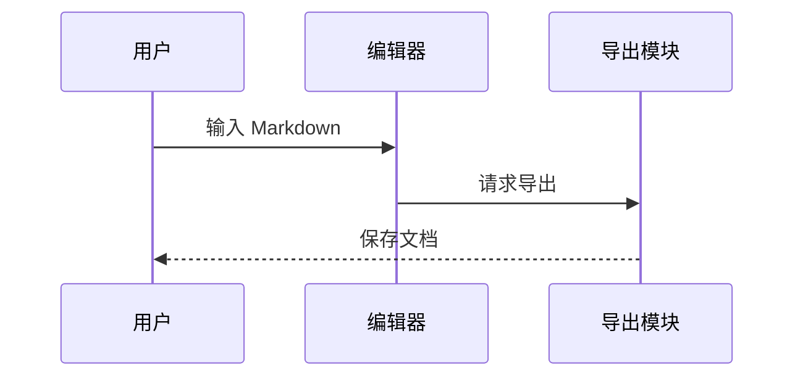
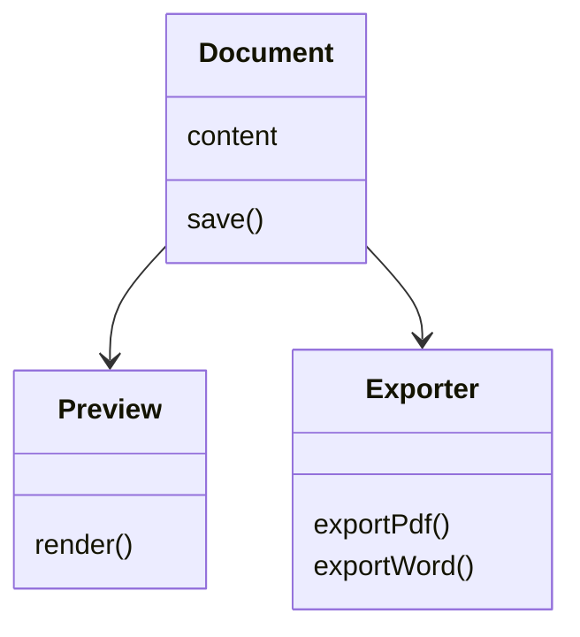

# Markdown Viewer 导出示例

这是公开的虚构示例，用于检查中文、Mermaid 图表和表格导出。所有内容均为演示数据。

**测试目标：**PDF 内容完整，Word 文本可编辑，图表作为图片嵌入。

## 一、文档流程

| 步骤 | 预期结果 |
| --- | --- |
| 打开 | 正确显示中文 |
| 预览 | 正确渲染图表 |

## 二、交互顺序

| 操作 | 结果 |
| --- | --- |
| 编辑 | 更新预览 |
| 保存 | 写入本地文件 |

## 三、模块结构

| 模块 | 用途 |
| --- | --- |
| Document | 管理内容 |
| Preview | 渲染预览 |

## 四、排版检查

支持 **加粗文本**、*斜体文本* 和 `行内代码`。

- 无序列表第一项
- 无序列表第二项

1. 有序列表第一项
2. 有序列表第二项

| 格式 | 示例 |
| --- | --- |
| 中文 | 正常显示 |
| 英文 | Markdown Viewer |

## 五、菜单操作

右键文档可重命名、打开所在文件夹、复制文件路径或关闭文档。

| 文档状态 | 操作 |
| --- | --- |
| 已保存 | 可打开所在文件夹 |
| 未保存 | 路径操作置灰 |

## 六、兼容性检查

文件名包含空格和中文，用于检查文件夹定位功能。

| 导出格式 | 检查项 |
| --- | --- |
| PDF | 中文与图表完整 |
| Word | 三张图表与六个表格 |
