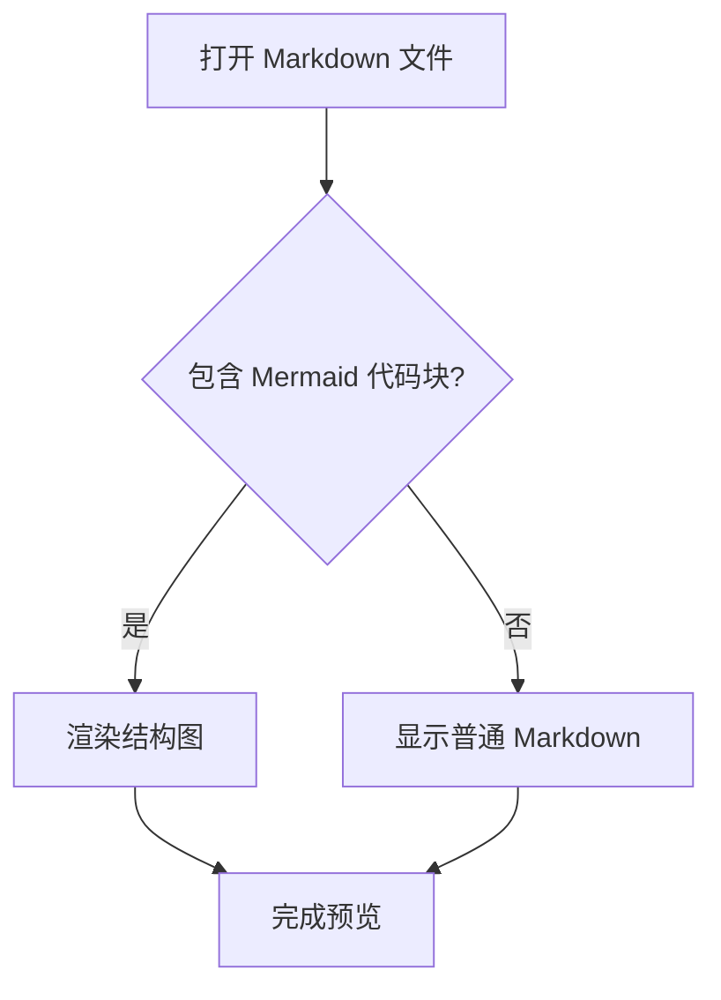
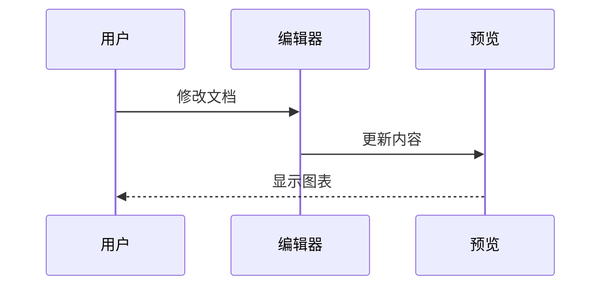

# Mermaid 预览示例

在编辑器中打开本文件，切换到分栏或预览模式，下面的代码块应显示为图表。

## 流程图



## 时序图



## 手动检查

- 切换浅色和深色主题，图表应更新配色。
- 修改节点文字，预览应自动更新。
- 临时输入错误语法，应保留源码并显示错误提示，其他图表仍正常显示。
- 快速切换文档，旧图表不应出现在新文档中。
- 普通代码块应继续保持原有显示和语法高亮。

异步渲染回归测试（Node.js 22.3 或以上）：

```sh
node --experimental-test-module-mocks --test src/mermaid-preview.test.js
```
